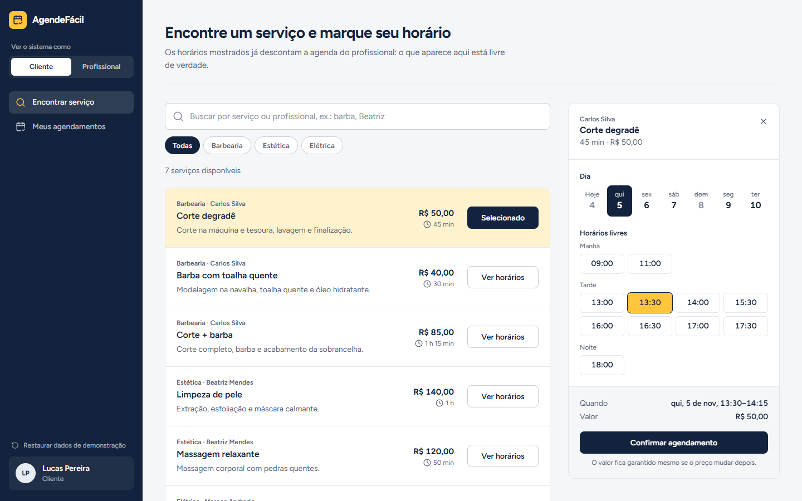

# Sistema de Agendamento para Prestadores de Serviço

Projeto acadêmico: clientes encontram profissionais e marcam horário em poucos toques.



## Escopo do MVP
- **Cliente**: cadastro e login, busca de serviço ou profissional, agendamento em horário livre, acompanhamento e cancelamento (mínimo de 2h de antecedência).
- **Profissional**: cadastro e login, serviços (duração e preço), disponibilidade semanal, agenda do dia, conclusão e falta, dashboard (faturamento e atendimentos).

## Regras de Negócio
1. O horário deve estar dentro da disponibilidade do profissional.
2. Não pode haver sobreposição com outro agendamento ativo do mesmo profissional (`fim = início + duração do serviço`).
3. O cliente só cancela com pelo menos 2h de antecedência.
4. Ao marcar como CONCLUÍDO, o valor entra no faturamento.
5. O preço é congelado no agendamento.

## Tecnologias
- **Backend:** Spring Boot, Java 21, Spring Data JPA, Spring Security, PostgreSQL, Maven.
- **Frontend:** React 19, TypeScript, Tailwind CSS v4, Lucide Icons, Vite.
- **Modelagem:** Astah UML (`Projeto_Agenda.asta`) e Mermaid.

## Estrutura do Projeto
```
backend/   API REST em Spring Boot (controller, service, repository, model, dto, config)
frontend/  Protótipo codificado em React: tela principal, CRUDs, agenda e dashboard
docs/      Especificação dos casos de uso, diagramas, imagens do protótipo e roteiro da apresentação
```

## Documentação
- [Especificação de todos os casos de uso (UC01 a UC09)](docs/especificacao_casos_de_uso.md)
- [Diagrama de casos de uso](docs/diagrama_casos_de_uso.md)
- [Diagrama de classes](docs/diagrama_classes.md)
- [Diagrama de pacotes e arquitetura](docs/diagrama_pacotes.md)
- [Diagrama de sequência do agendamento](docs/diagrama_sequencia_agendamento.md)
- [Sistema visual do protótipo](DESIGN.md)
- [Roteiro da apresentação da Etapa 2](docs/apresentacao_etapa2.md)
- [Backlog do produto](docs/backlog_produto.md)

## Protótipo codificado

| Tela | Caso de uso | Endereço |
|---|---|---|
| Tela principal (buscar e agendar) | UC02 | `/#/inicio` |
| Meus agendamentos | UC03, UC04 | `/#/meus-agendamentos` |
| Agenda do profissional | UC07, UC08 | `/#/agenda` |
| CRUD de serviços | UC05 | `/#/servicos` |
| CRUD de disponibilidade | UC06 | `/#/disponibilidade` |
| Dashboard | UC09 | `/#/dashboard` |

O seletor **Ver o sistema como** (Cliente / Profissional) na barra lateral troca de perfil sem login. Os dados de demonstração ficam no `localStorage` e são gerados a partir da data de hoje; o botão **Restaurar dados de demonstração** volta ao estado inicial.

### Como executar
```bash
cd frontend
npm install
npm run dev
```
Acesse `http://localhost:3000`.
