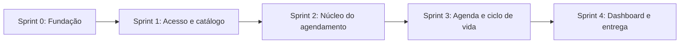

# Backlog do Produto: MVP Agendamento para Prestadores de Serviço

**Legenda de prioridade:** 🔴 Must (MVP não existe sem) · 🟡 Should (importante) · 🟢 Could (se sobrar tempo)
**Tamanho:** P (≤ 0,5 dia) · M (1 dia) · G (2 dias ou mais)

## Visão geral das sprints

---

## Épico 0: Fundação (Sprint 0)

| ID | Item | Prio | Tam | Critério de aceite |
|---|---|---|---|---|
| T-01 | Criar repositório GitHub, estrutura `backend/` e `frontend/`, README e `.gitignore` | 🔴 | P | Repositório clonável e README com instruções de execução |
| T-02 | Configurar projeto Spring Boot (Web, JPA, Security, Validation, PostgreSQL) | 🔴 | P | `mvn spring-boot:run` sobe a aplicação |
| T-03 | Configurar PostgreSQL (docker-compose) e migrations (Flyway) | 🔴 | M | Banco sobe com um comando e o schema é criado por migration |
| T-04 | Configurar projeto React + Vite + Tailwind + React Router | 🔴 | P | Página inicial renderiza com Tailwind |
| T-05 | Padrão de erros da API (`@ControllerAdvice`, formato JSON único) e CORS | 🔴 | P | Erros de regra retornam 4xx com mensagem legível |
| T-06 | Diagrama de classes (modelo de 7 entidades) | 🔴 | M | Diagrama revisado e salvo em `docs/` |
| T-07 | Diagrama de casos de uso (slide 6) | 🔴 | P | Cobre os dois perfis e todos os fluxos do slide 4 |
| T-08 | CI básico (build do backend e do frontend no GitHub Actions) | 🟢 | P | Pipeline verde no push |

---

## Épico 1: Acesso e identidade (Sprint 1)

| ID | História | Prio | Tam | Critério de aceite |
|---|---|---|---|---|
| US-01 | Como **cliente**, quero me cadastrar (nome, telefone, e-mail, senha) para poder agendar | 🔴 | M | E-mail único. Senha salva com hash (BCrypt). Cria `Usuario` e `Cliente`. |
| US-02 | Como **profissional**, quero me cadastrar (nome, especialidade, e-mail, senha) | 🔴 | M | Cria `Usuario` e `Profissional`. |
| US-03 | Como usuário, quero fazer login e logout | 🔴 | M | Retorna token (JWT) com o papel. Credenciais inválidas retornam 401. |
| US-04 | Como sistema, quero separar o acesso por papel (`CLIENTE` e `PROFISSIONAL`) | 🔴 | M | Endpoint de outro papel retorna 403. Rotas do frontend são protegidas. |
| US-05 | Tela de cadastro e login no frontend, com redirecionamento por papel | 🔴 | M | Cliente vai para a busca e profissional vai para a agenda. |

## Épico 2: Catálogo e disponibilidade do profissional (Sprint 1)

| ID | História | Prio | Tam | Critério de aceite |
|---|---|---|---|---|
| US-06 | Como **profissional**, quero cadastrar, editar e remover meus serviços (nome, duração, preço) | 🔴 | M | Duração > 0 e preço ≥ 0. Remover serviço com agendamentos futuros é bloqueado. |
| US-07 | Como **profissional**, quero definir minha disponibilidade semanal (dia, início e fim) | 🔴 | M | Início < fim. Permite várias faixas no mesmo dia (ex.: pausa de almoço). Faixas do mesmo dia não se sobrepõem. |
| US-08 | Tela "Meu perfil": serviços e disponibilidade | 🔴 | G | Edição funcional com validação de formulário. |

## Épico 3: Descoberta e agendamento (Sprint 2)

| ID | História | Prio | Tam | Critério de aceite |
|---|---|---|---|---|
| US-09 | Como **cliente**, quero pesquisar por serviço ou profissional | 🔴 | M | Busca por texto no nome do serviço, do profissional ou na especialidade. Retorna serviço, profissional, duração e preço. |
| US-10 | **Cálculo de horários livres** (`HorarioService.calcularHorariosLivres`) | 🔴 | G | Gera os horários a partir da disponibilidade e da duração. Remove os que colidem com agendamentos ativos. Ignora horários passados. Cobertura de testes unitários. |
| US-11 | Como **cliente**, quero ver só os horários livres de um profissional para um serviço em uma data | 🔴 | M | Endpoint de consulta. Não lista horário ocupado. |
| US-12 | Como **cliente**, quero confirmar um agendamento | 🔴 | G | Valida disponibilidade e sobreposição. Calcula `fim`. Congela o `precoCobrado`. Status inicial `AGENDADO`. |
| US-13 | **Proteção contra agendamento duplo** (concorrência) | 🔴 | M | Validação na transação com lock ou constraint. Teste com duas requisições simultâneas: só uma é aceita. |
| US-14 | Telas de busca e novo agendamento (serviço → profissional → data → horário → confirmar) | 🔴 | G | Fluxo completo do slide 4 funcionando. Horário ocupado não é selecionável. |

## Épico 4: Ciclo de vida do agendamento (Sprint 3)

| ID | História | Prio | Tam | Critério de aceite |
|---|---|---|---|---|
| US-15 | Como **cliente**, quero ver meus agendamentos (futuros e histórico) | 🔴 | M | Lista com serviço, profissional, data e status. |
| US-16 | Como **cliente**, quero cancelar com antecedência mínima de 2h | 🔴 | M | Menos de 2h retorna erro claro. Status vira `CANCELADO` e o horário é liberado. |
| US-17 | Como **profissional**, quero ver minha agenda do dia e navegar entre dias | 🔴 | G | Lista ordenada por horário com cliente, serviço e status. |
| US-18 | Como **profissional**, quero marcar `CONCLUIDO` | 🔴 | M | Só a partir de `AGENDADO`. O valor entra no faturamento. |
| US-19 | Como **profissional**, quero marcar `FALTOU` | 🔴 | P | Só a partir de `AGENDADO`. Não gera faturamento. |
| US-20 | Como **profissional**, quero cancelar um agendamento | 🟡 | P | Sem regra das 2h. Libera o horário. |
| US-21 | **Máquina de estados**: transições válidas centralizadas no service | 🔴 | M | Transição inválida retorna 409. Testes cobrem todas as combinações. |

## Épico 5: Dashboard (Sprint 4)

| ID | História | Prio | Tam | Critério de aceite |
|---|---|---|---|---|
| US-22 | Como **profissional**, quero ver o faturamento do mês | 🔴 | M | Soma do `precoCobrado` dos `CONCLUIDO` no mês. Mudar o preço do serviço não altera o histórico. |
| US-23 | Como **profissional**, quero ver o total de atendimentos concluídos no mês | 🟡 | P | Contagem por mês. |
| US-24 | Como **profissional**, quero ver a taxa de cancelamento | 🟢 | P | Cancelados ÷ total no período. |
| US-25 | Tela de dashboard com cards simples | 🔴 | M | Mês selecionável. |

---

## Qualidade e entrega (transversal)

| ID | Item | Prio | Tam |
|---|---|---|---|
| Q-01 | Testes unitários das regras: disponibilidade, sobreposição, cancelamento 2h, preço congelado, transições | 🔴 | G |
| Q-02 | Testes de integração dos endpoints principais (Testcontainers ou H2) | 🟡 | G |
| Q-03 | Seed de dados de demonstração (profissionais, serviços, disponibilidade e clientes) | 🔴 | P |
| Q-04 | Documentação da API (Swagger/OpenAPI) | 🟡 | P |
| Q-05 | Diagrama de sequência do agendamento com conflito | 🔴 | M |
| Q-06 | Revisão de fuso horário (armazenar em UTC ou padronizar `America/Sao_Paulo`) | 🟡 | P |
| Q-07 | Estados de carregamento, erro e vazio nas telas | 🟡 | M |
| Q-08 | Roteiro de demonstração e README final (como rodar, como testar, decisões de projeto) | 🔴 | M |
| Q-09 | Teste ponta a ponta do fluxo completo (cliente agenda → profissional conclui → dashboard) | 🔴 | M |

---

## Definição de Pronto (DoD)
- Código no GitHub, com revisão por pull request.
- Regra de negócio coberta por teste unitário.
- Critérios de aceite validados manualmente.
- Sem erro no console ou no log nos fluxos principais.

## Critério de entrega do MVP
O fluxo abaixo funciona de ponta a ponta, sem intervenção manual no banco:

1. O profissional se cadastra, cria serviços e define a disponibilidade.
2. O cliente se cadastra, busca, vê só horários livres e agenda.
3. Um segundo cliente não consegue o mesmo horário.
4. O cliente cancela com 2h ou mais de antecedência e o horário é liberado.
5. O profissional conclui o atendimento e o faturamento do dashboard sobe.

## Riscos e dependências
- **US-10 e US-13** são o coração do produto e as mais arriscadas. Comece por elas na Sprint 2.
- **Autenticação (Sprint 1)** bloqueia todo o frontend. Não deixe para depois.
- **Fuso horário** causa bugs sutis no cálculo de horários. Decida em Q-06 antes da Sprint 2.
- **Se o prazo apertar**, corte nesta ordem: US-24, US-23, US-20, Q-08 (parte opcional), T-08.

## Resumo
| Épico | Itens 🔴 | Itens 🟡 | Itens 🟢 |
|---|---|---|---|
| Fundação | 7 | 0 | 1 |
| Acesso | 5 | 0 | 0 |
| Catálogo | 3 | 0 | 0 |
| Agendamento | 6 | 0 | 0 |
| Ciclo de vida | 6 | 1 | 0 |
| Dashboard | 2 | 1 | 1 |
| Qualidade | 5 | 4 | 0 |
