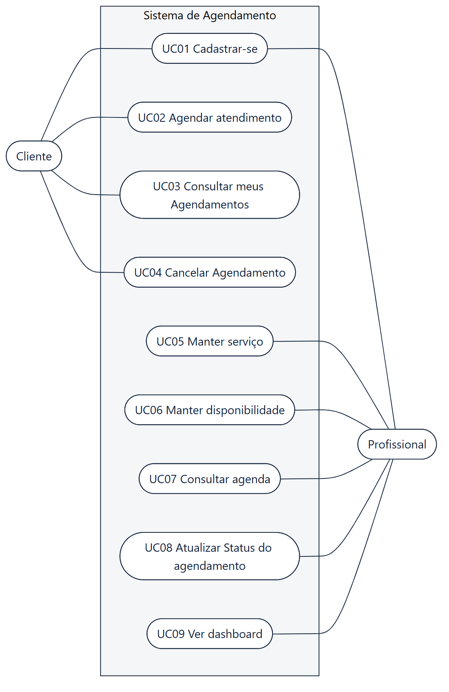
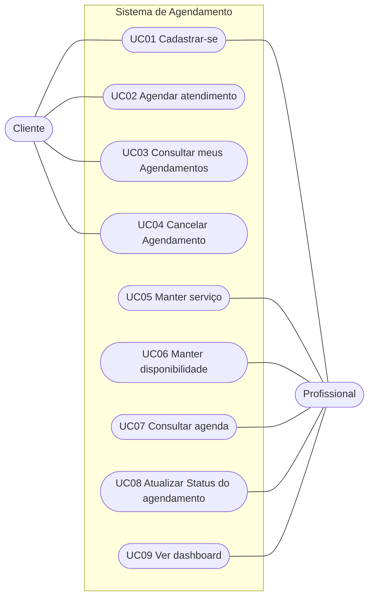

# Diagrama de Casos de Uso

Espelha o diagrama do Astah (`Projeto_Agenda.asta`, pacote `1.Analise › Modelo de Casos de Uso`). A especificação de cada caso de uso está em [especificacao_casos_de_uso.md](especificacao_casos_de_uso.md).

> Fonte: [`diagramas/casos_de_uso.mmd`](diagramas/casos_de_uso.mmd)

