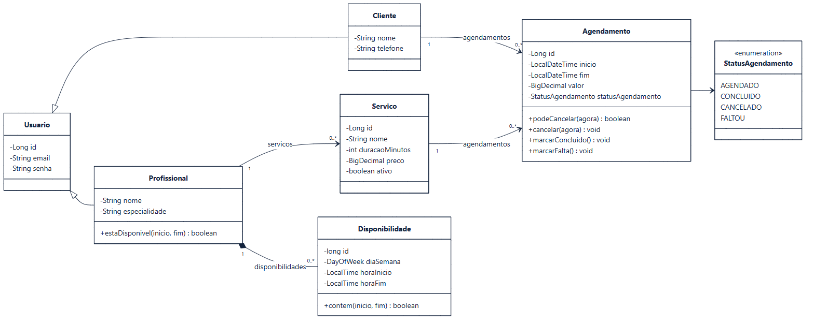
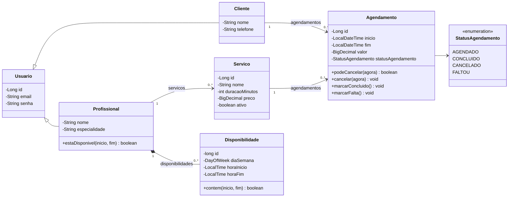

# Diagrama de Classes

Espelha o diagrama do Astah (`Projeto_Agenda.asta`, pacote `2.Desing › Modelo de Objeto › Objetos`), acrescido das operações que implementam as regras de negócio.

> Fonte: [`diagramas/classes.mmd`](diagramas/classes.mmd)

## Regras de negócio no modelo

| Regra | Onde fica |
|---|---|
| `fim = inicio + servico.duracaoMinutos` | criação do `Agendamento` |
| Preço congelado: `valor` recebe uma cópia de `Servico.preco` no momento do agendamento | criação do `Agendamento` |
| Sem sobreposição: nenhum agendamento AGENDADO do mesmo profissional com `inicio < outro.fim && fim > outro.inicio` | `Profissional.estaDisponivel` |
| Horário dentro de uma `Disponibilidade` do dia da semana | `Disponibilidade.contem` |
| Cancelamento com no mínimo 2 h de antecedência | `Agendamento.podeCancelar` |
| Só agendamentos AGENDADO mudam de estado | `cancelar`, `marcarConcluido`, `marcarFalta` |

## Correspondência com o código

O modelo de implementação (`backend/src/main/java/com/agendamento/model`) mapeia as mesmas classes com JPA. Diferenças de nome entre o modelo do Astah e o código:

| Astah | Código (JPA) |
|---|---|
| `Agendamento.inicio` / `fim` | `dataHoraInicio` / `dataHoraFim` |
| `Agendamento.valor` | `precoCobrado` |
| `Agendamento.statusAgendamento` | `status` |
| `Disponibilidade.diaSemana : DayOfWeek` | `diaSemana : DiaSemana` (enum próprio) |
| Herança `Cliente`/`Profissional` → `Usuario` | associação 1:1 com `Usuario` (`@OneToOne`) e enum `PapelUsuario` |
