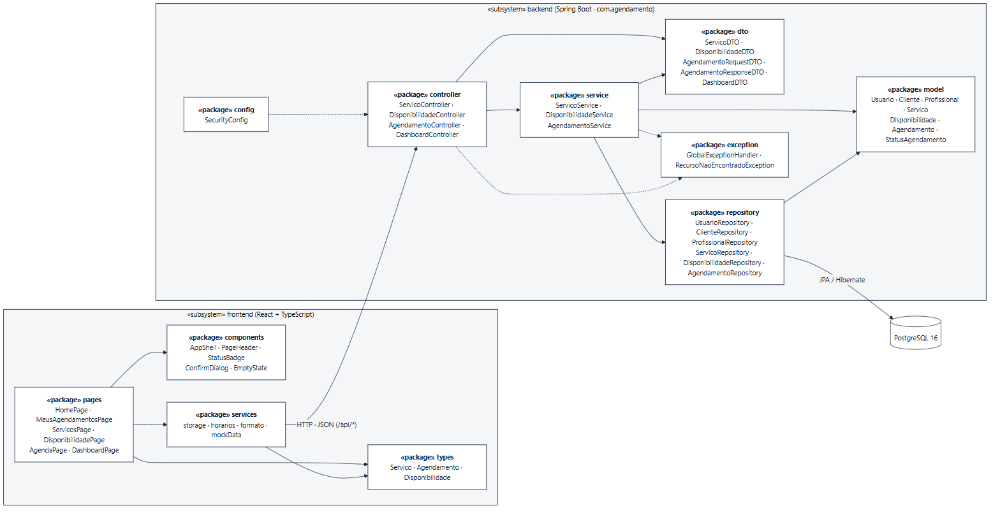
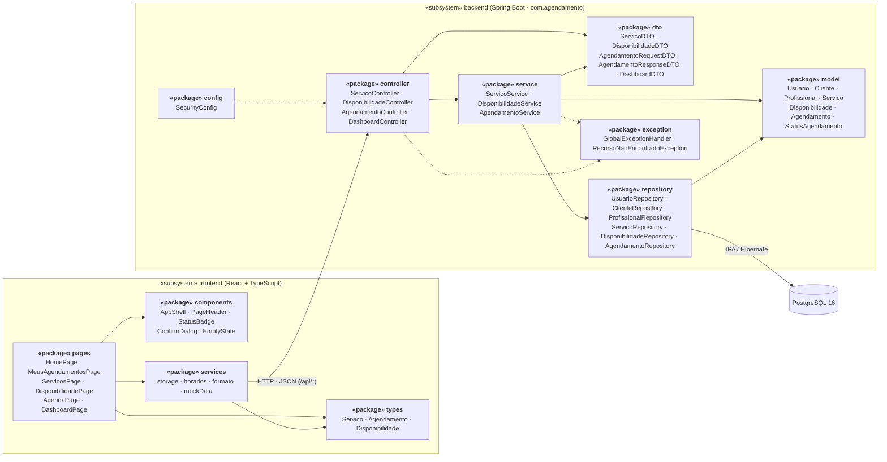

# Diagrama de Pacotes e Arquitetura

O sistema segue uma arquitetura **cliente-servidor em camadas**: um frontend React (SPA) conversa com uma API REST em Spring Boot, que persiste os dados no PostgreSQL. Cada camada depende apenas da camada logo abaixo.

> Fonte: [`diagramas/pacotes.mmd`](diagramas/pacotes.mmd)

## Camadas do backend

| Pacote | Responsabilidade |
|---|---|
| `config` | Segurança (Spring Security) e CORS. |
| `controller` | Endpoints REST: recebe a requisição, valida o DTO e devolve o código HTTP. |
| `dto` | Contratos da API, separados das entidades. |
| `service` | Regras de negócio: horários livres, conflito de horário, cancelamento com 2 h, preço congelado, faturamento. |
| `repository` | Interfaces Spring Data JPA, incluindo a consulta de conflito de horário. |
| `model` | Entidades JPA e enumerações do domínio. |
| `exception` | `GlobalExceptionHandler` converte as exceções em respostas `ProblemDetail` (RFC 7807): 404 para recurso inexistente, 400 para dados inválidos e 409 para regra de negócio violada. |

## Pacotes do frontend

| Pasta | Responsabilidade |
|---|---|
| `src/pages` | Uma tela por caso de uso (tela principal, CRUDs, agenda, dashboard). |
| `src/components` | Peças reutilizadas entre telas: estrutura com navegação, cabeçalho, selo de estado, diálogo de confirmação, estado vazio. |
| `src/services` | Acesso a dados (hoje `localStorage` com dados de demonstração; na Etapa 3, a API), cálculo de horários livres e formatação. |
| `src/types` | Tipos TypeScript espelhando os DTOs da API. |

## Endpoints

| Método | Rota | Caso de uso |
|---|---|---|
| `GET` | `/api/servicos?busca=` | UC02 |
| `POST` `PUT` `PATCH` `DELETE` | `/api/servicos[/{id}]` | UC05 |
| `GET` `POST` `PUT` `DELETE` | `/api/disponibilidades[/{id}]` | UC06 |
| `POST` | `/api/agendamentos` | UC02 |
| `GET` | `/api/agendamentos/cliente/{id}` | UC03 |
| `PATCH` | `/api/agendamentos/{id}/cancelar` | UC04, UC08 |
| `GET` | `/api/agendamentos/profissional/{id}` | UC07 |
| `PATCH` | `/api/agendamentos/{id}/concluir` · `/falta` | UC08 |
| `GET` | `/api/dashboard/profissional/{id}` | UC09 |
